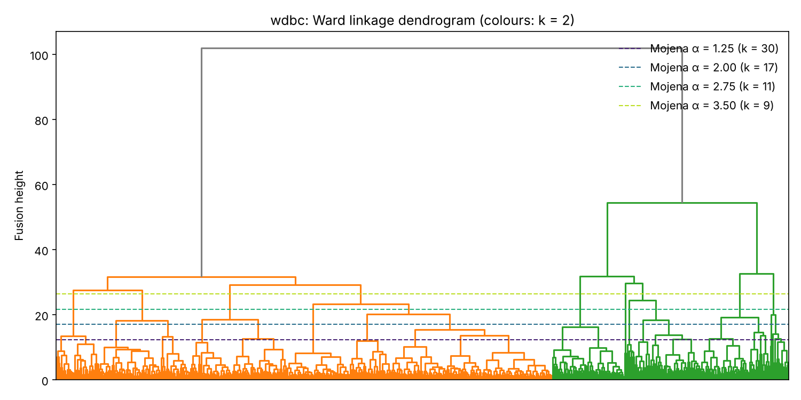
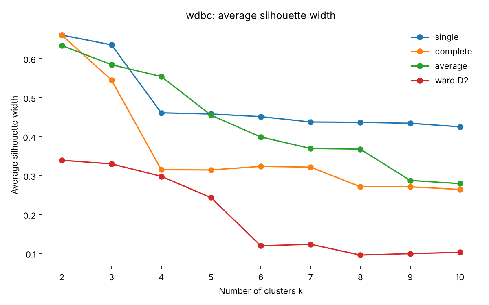

# Determining the Number of Clusters in Hierarchical Clustering

**B.Sc. thesis, Amirkabir University of Technology (2015)** · Saman Zameni · Supervisor: Prof. Adel Mohammadpour

Hierarchical clustering produces a full dendrogram, but most applications need a single partition, so the analyst has to decide where to cut the tree. This project compares rules for choosing the number of clusters *k*, focusing on **Mojena's stopping rule** (Mojena, 1977), on two real data sets with known class labels. Because the true classes are known, every chosen partition can be scored objectively.

> The code in this repository is a 2026 refactoring of the original thesis scripts (which remain in the git history). It fixes several issues in those scripts, including unscaled features, the class label being used as a clustering feature, and hard-coded file paths. It also adds an external evaluation that the original analysis did not have.

## Method

**Data sets**

| Data set | n | Features | Distance | Known classes |
|---|---|---|---|---|
| Breast Cancer Wisconsin (Diagnostic) | 569 | 30 numeric | Euclidean on standardised features | benign / malignant |
| Cleveland Heart Disease | 303 | 13 mixed (6 numeric, 7 categorical) | Gower dissimilarity | disease / no disease |

The class labels are never used for clustering; they are used only to evaluate the chosen partitions.

**Linkages:** single, complete, average and Ward (`ward.D2`). The centroid and median linkages are excluded because they can produce non-monotone dendrograms, which makes height-based stopping rules undefined.

**Rules for choosing *k*:**

- **Mojena's upper-tail rule:** stop at the first merge whose fusion height exceeds mean(h) + α·sd(h). Reported for α = 1.25 (Milligan & Cooper, 1985), 2.0, 2.75 and 3.5.
- **Largest jump:** cut where the increase in fusion height between consecutive merges is largest (*k* = 2–10).
- **Average silhouette width:** the *k* in 2–10 with the highest average silhouette (Rousseeuw, 1987).
- **NbClust majority vote:** majority vote over six indices (CH, DB, silhouette, Hartigan, Duda–Hart, McClain). Euclidean data only.

**Evaluation**

- **Adjusted Rand Index (ARI)** between each chosen partition and the true classes. ARI is 1 for perfect agreement and about 0 at chance level.
- **Cophenetic correlation** for each linkage.
- **Non-hierarchical baselines** at the true *k*: k-means (25 random starts) and PAM (k-medoids) on the Gower dissimilarity.

## Results

The numbers and figures below were produced by `python/reproduce_results.py`, which implements the same linkages, rules and evaluation with SciPy and scikit-learn. The NbClust vote is R-only and is not included. Each cell shows **chosen *k* (ARI)**.

**Breast Cancer Wisconsin (Euclidean, standardised)**

| Rule | single | complete | average | Ward |
|---|---|---|---|---|
| Mojena α = 1.25 | 41 (0.03) | 46 (0.12) | 48 (0.44) | 30 (0.07) |
| Mojena α = 2.00 | 25 (0.02) | 27 (0.27) | 26 (0.60) | 17 (0.14) |
| Mojena α = 2.75 | 13 (0.02) | 13 (0.40) | 15 (0.10) | 11 (0.20) |
| Mojena α = 3.50 | 11 (0.02) | 9 (0.54) | 9 (0.13) | 9 (0.28) |
| Largest jump | 2 (0.00) | 3 (0.01) | 3 (0.00) | **2 (0.58)** |
| Silhouette | 2 (0.00) | 2 (0.00) | 2 (0.01) | **2 (0.58)** |
| *True k = 2* | *2 (0.00)* | *2 (0.00)* | *2 (0.01)* | *2 (0.58)* |

**Cleveland Heart Disease (Gower)**

| Rule | single | complete | average | Ward |
|---|---|---|---|---|
| Mojena α = 1.25 | 34 (0.02) | 39 (0.04) | 38 (0.08) | 19 (0.05) |
| Mojena α = 2.00 | 8 (0.01) | 18 (0.07) | 16 (0.22) | 12 (0.09) |
| Mojena α = 2.75 | 4 (0.00) | 10 (0.11) | 6 (0.32) | 7 (0.10) |
| Mojena α = 3.50 | 2 (0.00) | 3 (0.09) | 2 (0.00) | 5 (0.15) |
| Largest jump | 2 (0.00) | 2 (0.09) | 2 (0.00) | **2 (0.31)** |
| Silhouette | 2 (0.00) | 10 (0.11) | 2 (0.00) | **2 (0.31)** |
| *True k = 2* | *2 (0.00)* | *2 (0.09)* | *2 (0.00)* | *2 (0.31)* |

**Cophenetic correlation and baselines**

| | single | complete | average | Ward | Baseline at k = 2 |
|---|---|---|---|---|---|
| Breast cancer | 0.79 | 0.68 | **0.84** | 0.59 | k-means: ARI 0.67 |
| Heart disease | 0.41 | 0.51 | **0.63** | 0.54 | PAM: ARI 0.39 |





### Findings

1. **Mojena's rule over-segments these data sets.** With the recommended α = 1.25 it selects 19–48 clusters, even though each data set has two classes. Fusion heights in real data have a long right tail, so many merges exceed mean + 1.25·sd. Larger α values reduce *k*, but no single α works across linkages and data sets.
2. **A high silhouette does not imply a meaningful partition.** At *k* = 2, single, complete and average linkage reach the highest silhouette values (≈ 0.66 on the breast cancer data), yet their ARI is about 0. These linkages split off 1–3 outlying observations and leave everything else in one cluster.
3. **Ward linkage recovers the class structure best.** It produces balanced clusters (385/184 and 142/161), and both the largest-jump and the silhouette rule choose *k* = 2 with it, giving ARI 0.58 (breast cancer) and 0.31 (heart disease).
4. **The best-fitting tree is not the most useful one.** Average linkage has the highest cophenetic correlation on both data sets but separates the classes poorly. On the breast cancer data, k-means (ARI 0.67) does slightly better than any hierarchical partition.

## Repository structure

```
run_all.R                  main script: runs everything, writes results/ and figures/
install_packages.R         installs the required CRAN packages
R/data.R                   data loading, scaling and dissimilarities
R/stopping_rules.R         Mojena, largest-jump, silhouette and NbClust rules
R/evaluation.R             cophenetic correlation, ARI, baselines
R/plots.R                  dendrograms, fusion-height and silhouette plots
tests/test_stopping_rules.R  checks the rules on synthetic data with 3 known clusters
python/reproduce_results.py  Python implementation that produced the results above
data/                      the two data sets as labelled CSV files
results/, figures/         tables and figures reported in this README
```

## How to run

Requires R ≥ 4.0. From the repository root:

```r
source("install_packages.R")   # cluster, mclust, NbClust (first time only)
source("tests/test_stopping_rules.R")
source("run_all.R")
```

or from a terminal: `Rscript run_all.R`. Results are written to `results/` (CSV tables) and `figures/` (PNG plots). The random seed is fixed (`set.seed(42)`), so the k-means baseline is reproducible.

To reproduce the reported results with Python instead:

```bash
pip install numpy pandas scipy scikit-learn matplotlib
python python/reproduce_results.py
```

## Data notes

- **Breast Cancer Wisconsin (Diagnostic):** Wolberg, Street & Mangasarian, UCI Machine Learning Repository. The diagnosis column was restored by matching the feature rows to the UCI release.
- **Cleveland Heart Disease:** Detrano et al., UCI Machine Learning Repository. The original `num` attribute (0 = no disease, 1–4 = disease) is binarised. In this copy of the file the missing values of `ca` had already been filled in, and one missing `thal` value is recorded as `NA`; Gower's dissimilarity handles it.
- Ward linkage assumes Euclidean distances. Its results on the Gower dissimilarity (heart data) are reported for comparison, but they should be read with this caveat.

## References

- Mojena, R. (1977). Hierarchical grouping methods and stopping rules: an evaluation. *The Computer Journal*, 20(4), 359–363.
- Milligan, G. W., & Cooper, M. C. (1985). An examination of procedures for determining the number of clusters in a data set. *Psychometrika*, 50(2), 159–179.
- Rousseeuw, P. J. (1987). Silhouettes: a graphical aid to the interpretation and validation of cluster analysis. *Journal of Computational and Applied Mathematics*, 20, 53–65.
- Gower, J. C. (1971). A general coefficient of similarity and some of its properties. *Biometrics*, 27(4), 857–871.
- Hubert, L., & Arabie, P. (1985). Comparing partitions. *Journal of Classification*, 2(1), 193–218.
- Charrad, M., Ghazzali, N., Boiteau, V., & Niknafs, A. (2014). NbClust: an R package for determining the relevant number of clusters in a data set. *Journal of Statistical Software*, 61(6), 1–36.
